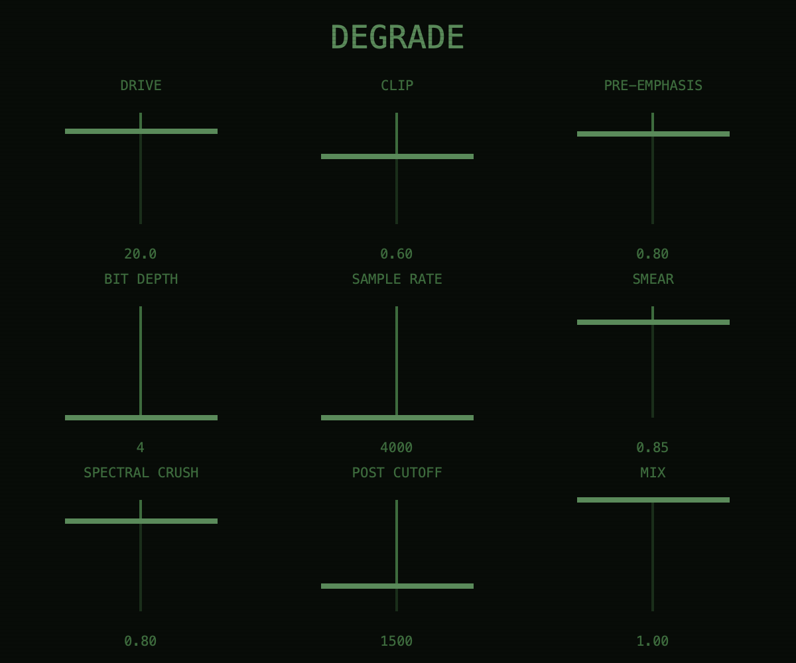
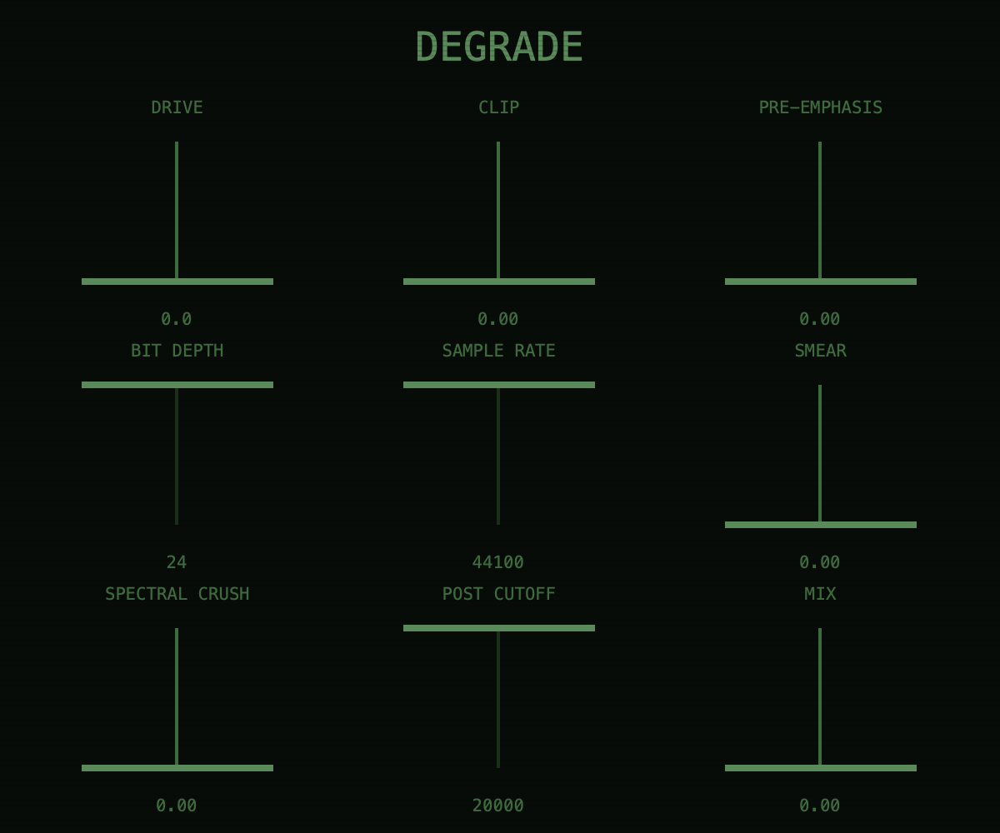
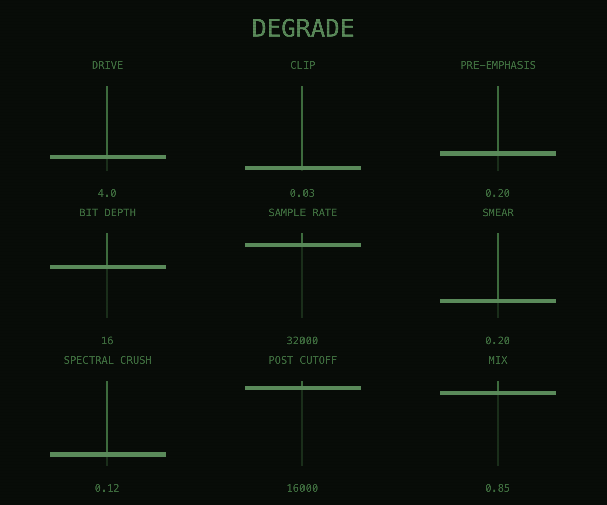

# Degrade

**A codec-degradation and spectral-destruction effect for macOS (Audio Unit), built with JUCE.**



Degrade makes audio sound like it's barely holding together. It aims for the sound of a file
that has gone through too many lossy encodes and is coming apart spectrally. It goes beyond a
lowpass or a distortion: it adds aliasing, quantisation noise, starved FFT bins and smeared
phase, the actual artefacts of a broken codec. It was inspired by the lo-fi digital texture on
fred again.. & Brian Eno's *"Trying"*.

Turn it up a little for a "128 kbps" haze, or all the way for full digital rot.

---

## Signal chain

```
in ─► Drive + tanh soft clip ─► Pre-emphasis shelf ─► Bit crusher ─► Sample-rate reducer
   ─► FFT spectral smear / crush ─► Post low-pass ─► Mix ─► out
        (dry path delayed 768 samples to stay phase-aligned)
```

| Stage | What it does |
|-------|--------------|
| **Drive / Clip** | Up to +24 dB into a `tanh` soft clipper whose hardness Clip sets. |
| **Pre-Emphasis** | A 0–12 dB high shelf at ~4 kHz, so the highs hit the quantiser harder, as in a real codec. |
| **Bit Depth** | Quantises to 24 down to 4 bits. |
| **Sample Rate** | Sample-and-hold down to 4 kHz. No anti-alias filter, so the aliasing stays in. |
| **Smear** | A 1024-point FFT with 75% overlap. It blends each bin's phase toward random, so transients blur into a watery wash. |
| **Spectral Crush** | Randomly zeroes FFT bins, with high frequencies dropped first. This is the "starved bitrate" warble of a low-quality MP3. |
| **Post Cutoff** | A one-pole low-pass from 20 kHz down to 1 kHz. |
| **Mix** | Dry/wet. The dry path is delayed to match the FFT latency, so blending doesn't comb-filter. |

## Presets

Ten factory presets, roughly from subtle to destroyed:

**128kbps Jesus** · **Napster Ghost** · **Bitrot Elegy** · **RealPlayer Tomb** · **WinAmp Funeral** ·
**ICQ Transmission** · **Dial-Up Seance** · **Kazaa Worm** · **56k Requiem** · **Bin Heaven**

| Default (bypass-clean) | Napster Ghost |
|---|---|
|  |  |

## Parameters

| Control | Range | Default |
|---------|-------|---------|
| Drive | 0–24 dB | 0 dB |
| Clip | 0–1 | 0 |
| Pre-Emphasis | 0–1 (0–12 dB) | 0 |
| Bit Depth | 4–24 bits | 24 |
| Sample Rate | 4–44.1 kHz | 44.1 kHz |
| Smear | 0–1 | 0 |
| Spectral Crush | 0–1 | 0 |
| Post Cutoff | 1–20 kHz | 20 kHz |
| Mix | 0–100% | 0% |

All the defaults are clean, so a new instance passes audio through untouched until you start
turning knobs or load a preset. Every continuous control is smoothed, so automation doesn't
click. The plugin reports 768 samples of latency (the FFT window) to the host so it can
compensate.

## Building

Requirements: macOS 13+, Xcode command-line tools, CMake 3.22+.

```bash
git clone --recursive https://github.com/kolotammaman/Degrade.git
cd Degrade
cmake -B build -G Xcode
cmake --build build --config Release
```

JUCE 8.0.12 is included as a git submodule. If you cloned without `--recursive`, run
`git submodule update --init` first. The built `Degrade.component` is copied to
`~/Library/Audio/Plug-Ins/Components/`. Rescan AU plugins in your DAW to pick it up.

No third-party DSP libraries are used: just JUCE's FFT and the C++ standard library.

## License

[AGPL-3.0](LICENSE). Built on [JUCE](https://juce.com), which is used under its AGPLv3 license.

---

*Designed and built by molo in collaboration with Claude.*
